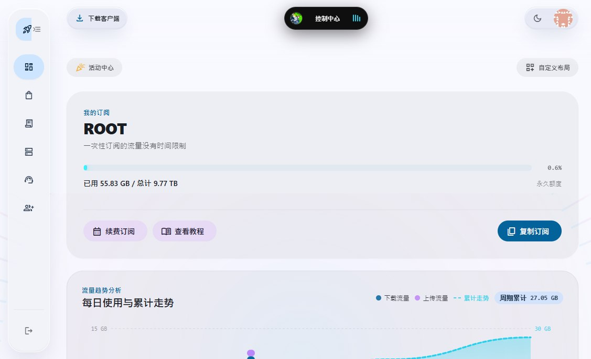
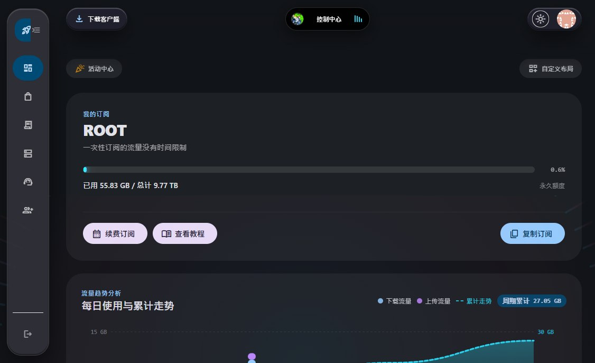
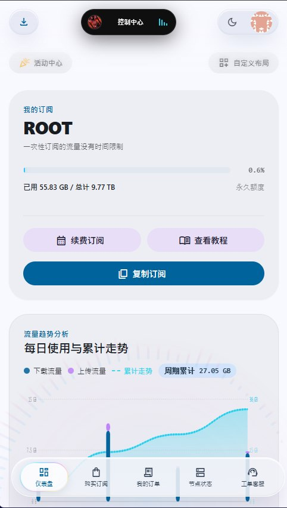
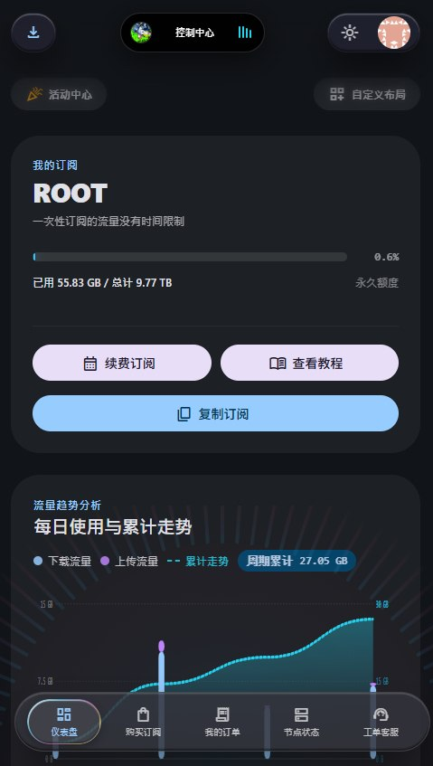

*<small>项目包含AI创作的内容</small>*

# 🌌 Xboard MD3 : Next-Gen Theme & Binary Accelerator

> 基于 **Google Material Design 3** 设计语言打造的次世代网络管理面板开源主题。
> 搭载全新 **MessagePack** 二进制化json传输加速引擎，并内嵌 E2EE 零知识资源管理中心接口与 Komari 探针无特权安全遥测系统。

[](https://opensource.org/licenses/MIT)
[](https://vuejs.org/)
[](https://vitejs.dev/)
[](https://nodejs.org)
[](https://www.typescriptlang.org/)
[](https://m3.material.io/)


---

<div align="center">

##  界面视觉预览 (UI Showcase)

<table width="100%">
  <thead>
    <tr>
      <th width="15%" align="center">设备端 / 模式</th>
      <th width="42.5%" align="center"> 浅色模式 (Light Mode)</th>
      <th width="42.5%" align="center"> 深色模式 (Dark Mode)</th>
    </tr>
  </thead>
  <tbody>
    <!-- 第一行：PC 端样式 (横屏 16:9) -->
    <tr>
      <td align="center"><b> PC 端样式</b></td>
      <td align="center">
        <a href="./docs/6296339910851498825.png" target="_blank">
          
        </a>
      </td>
      <td align="center">
        <a href="./docs/6296339910851498826.jpg" target="_blank">
          
        </a>
      </td>
    </tr>
    <!-- 第二行：手机端样式 (竖屏限制最大宽度，防止竖向撑爆屏幕) -->
    <tr>
      <td align="center"><b> 手机端样式</b></td>
      <td align="center">
        <a href="./docs/6296339910851498828.jpg" target="_blank">
          
        </a>
      </td>
      <td align="center">
        <a href="./docs/6296339910851498827.jpg" target="_blank">
          
        </a>
      </td>
    </tr>
  </tbody>
</table>

</div>

---

##  核心特性亮点

### 1. 双重全链路反检测与路径混淆 (Anti-DPI & Fingerprint Eradication)
* **URL 动态加盐哈希栈**：采用客户端独立熵源（Master Seed + 瞬时 Salt），地址栏始终呈现为高熵乱码（如 `/#/f34fd323e...`）。**每次页面刷新或路由切换自动重新洗牌变幻**，彻底失效基于关键词的审查规则；同时内置逃生引擎，对邮件免密链接与邀请码保持 100% 向下兼容。
* **API 动态网关 (RC4 Stream Cipher)**：发出的接口路径在出站前动态混淆加密（如 `/api/v1/user/server/fetch` 突变为 `/api/v1/e/8a4f9b...`），连带查询参数一同加密隐藏；外部审查无法截获任何 `server`、`plan`、`subscribe` 等敏感明文端点。

### 2. 纯正 MD3 物理动效与液态美学
- **真·液态玻璃 (Liquid Glass)**：底栏与顶栏摒弃生硬的单层高斯模糊，采用比背景深 10% 的物理胶质基底，配备边缘 $1.5\text{px}$ 棱镜水滴彩虹色散光折射（Rainbow Dispersion）。
- **非线性物理弹簧动画 (Spring Physics)**：采用 `cubic-bezier(0.34, 1.56, 0.64, 1)` 弹性超调曲线，侧边栏与底栏之间具备平滑流动形变，支持任意时刻动作打断并无缝平滑反弹。
- **阶梯色调表面 (Tonal Elevation)**：暗黑模式彻底清除所有突兀的白色描边线，完全依靠 `surface-container` 层次承托。

### 3. 透明 MessagePack 二进制传输
- 配合专属 companion 插件 `ThemeApiAdapter`，前端使用 `Accept: application/msgpack`。
- **绝对安全**：后端在数据出站的最后一毫米进行透明编码，请求 100% 经过 Xboard 原生中间件、鉴权机制与权限过滤，零越权风险。
- **性能飞跃**：网络传输体积减少 30%~50%，前端直接于内存中解析 TypedArray，彻底解决大 JSON 词法解析阻塞主线程导致的掉帧。

### 4. Google 风格多账号免密无缝热切换
- 顶栏配备高保真 Google Account 面板，支持在同一设备内无感暂存与切换多个账户凭证，切换耗时 $<50\text{ms}$。
- 具备完善的退出策略：支持“仅退出当前账号并自动切至备用”或“彻底清空本机全量凭据”。

### 5. 自由布局控制中心 (Dashboard Sandbox)
- 4×4 弹性栅格引擎，允许用户拖拽卡片、调节卡片尺寸（4×2 全宽 / 2×2 半宽），支持卡片显隐与一键重置，配置本地持久化。
- 原生 SVG 流量时序图表：按自然日精确聚合、自适应双 Y 轴量化刻度、叠加累计总量平滑走势曲线。

### 6. 零知识 E2EE 加密下载中心
- 原生集成软件分发中心，前端基于 Web Crypto API 进行 **AES-256-GCM 硬件并行解密**。
- 支持**Service Worker 虚拟切片流媒体 (`sw.js`)**串流为视频内容快速在线串流提供支持：拦截浏览器 Range 请求，结合启发式速率预测、滑动窗口背压流控与零内存拷贝切片，支持 4K 视频边下边解密边播放，即使拖拽倒放也能自动无感补块，并同步集成 WebSocket 全网同屏弹幕。

### 7. 安全无特权 Komari 探针遥测
- 原生接入母机物理监控，采用只读免密 JSON-RPC 2.0 规范，全端无特权泄露。
- 移动端自动转为向上滑出的圆角抽屉，支持手势下拉跟手关闭。

### 8. 其他
- 页面标题灵动岛有隐藏彩蛋，配合下载中心创建music并上传音频文件即可实现......


---

##  项目架构组成

```text
├── plugins/
│   └── ThemeApiAdapter/     # [后端插件] Xboard 官方透明二进制传输加速中间件
├── src/                     # [前端源码] Vue 3.5 + TypeScript + Vite 主题工程
├── public/
│   └── sw.js                # [流媒体核心] E2EE 虚拟切片流控 Service Worker
├── scripts/
│   └── pack-theme.mjs       # [构建流水线] 自动化 POSIX 正斜杠目录级主题打包脚本
├── theme.config.json        # [主题配置元文件] Xboard 后台可视设置项声明
└── API_DEVELOPMENT.md       # [核心文档] Xboard 客户端 API 权威参考手册
```

---

##  部署与安装指南

整个项目分为 **后端加速插件** 与 **前端主题包** 两个独立部分，完全解耦：

### 第一步：安装后端安全路径混淆与加速插件 `ThemeApiAdapter` (务必！否则无法正常工作)

本插件采用纯 PHP 实现，**服务器无需安装任何 PECL C 语言扩展，上传即用**。

1. 进入 Releases 页面下载 `ThemeApiAdapter.zip`或者下载仓库的 **/Plugin** 目录里面的所有内容（不含Plugin文件夹本身）自行压缩为zip；
2. 登录 Xboard 管理后台 -> **插件管理** -> 点击 **上传插件**，上传 ZIP 文件；
3. 点击 **启用** 插件；
4. **重启后端服务**（由于 Xboard 基于 Swoole/Octane 常驻内存，必须重载进程）：
   ```bash
   # 若为 Docker 部署：
   docker restart xboard
   # 若为宿主机原生运行：
   php artisan octane:reload
   ```

### 第二步：安装前端主题 `MD3-Theme`

1. 进入 Releases 页面下载最新的 `MD3-Theme.zip`；
2. 登录 Xboard 管理后台 -> **主题管理** -> 点击 **上传主题**；
3. 在主题列表中找到 `MD3-Theme`，点击 **切换使用**；
4. 点击该主题的 **配置 / 设置**，根据需求调整后台选项并保存。

### 第三步：配置独立安全下载存储中心 (可选)

若需要使用主题内的“独立软件库”与“零知识 E2EE 视频播放器”，需配套部署后端 Node.js 存储服务：
- 存储方案服务端项目仓库：👉 **[ReiaDown-Secure-Storage](https://github.com/ReiaKurona/ReiaDown-Secure-Storage)**
- 部署好后，将服务域名（例如 `https://install.example.com`）填入本主题设置中的 `下载中心 Node 服务地址` 即可。

---

##  主题设置项解析 (`theme.config.json`)

在 Xboard 后台【主题管理】->【设置】中可进行结构化定制：

| 配置项标签 | 字段名 | 类型 | 说明 |
| :--- | :--- | :--- | :--- |
| **自定义页脚 HTML** | `custom_html` | textarea | 允许注入统计脚本、自定义外挂浮动挂件等 |
| **站点背景图 URL** | `background_url` | input | 覆盖全站主体的背景图片链接 |
| **开启 Komari 探针监控** | `komari_enabled` | select | 是否在节点列表展示母机实时遥测数据卡片 |
| **Komari 探针公开地址** | `komari_url` | input | 你的探针访问端点，如 `https://stat.example.com` (末尾勿加斜杠) |
| **下载中心 Node 服务地址** | `download_center_url` | input | 专属加密资源库 API 地址，如 `https://install.example.com` |
| **开启全站活动悬浮窗** | `activity_float_enabled` | select | 当有活动时，是否在非首页右下角呈现 75% 不透明度 FAB 按钮 |
| **活动自定义代码** | `activity_custom_code` | textarea | 支持万能 HTML/CSS/JS 注入，使用一组 ````` ```` ```` `````包裹实现多活动分卡 |
| **自定义MD图标库 / 字体地址 (可选)** | `activity_custom_code` | textarea | 解决官方源加载慢导致图标错乱问题，留空默认走官方源。可填腾讯云OSS等woff2直链或各种开源镜像 |

###  多活动语法注入示例
在“活动自定义代码”文本框中输入：

`````html
````
<!-- 活动 1 -->
<div style="padding: 16px; text-align: center;">
  <h3 style="color: #38bdf8;">🎮 玩游戏领权益</h3>
  <p>每日打卡参与小游戏！领取福利</p>
</div>
````
````
<!-- 活动 2 -->
<div style="padding: 16px; text-align: center;">
  <h3 style="color: #f472b6;">🎁 限时特惠</h3>
  <p>单笔充值满 100 元赠送 20 元余额！</p>
</div>
````
`````
前端引擎会自动将其隔离沙盒化并渲染为 **活动 1**、**活动 2** 两张独立卡片，严格防样式溢出，并为内嵌弹窗放行全屏穿透。

---

##  本地二次开发指南

### 1. 准备本地环境
```bash
# 克隆仓库
git clone https://github.com/ReiaKurona/Xboard-Theme-Aether-M3.git
cd Xboard-Theme-MD3-Expressive

# 安装依赖
npm install
```

### 2. 本地开发与联调代理
打开 `vite.config.ts`，配置开发代理将 API 指向你的 Xboard 测试后端：
```typescript
server: {
  proxy: {
    '/api': {
      target: 'https://your-xboard-site.com',
      changeOrigin: true
    }
  }
}
```
启动开发服务：
```bash
npm run dev
```
打开 `http://localhost:5173/#/dashboard` 即可脱离 Laravel 环境进行纯正的前端单页调试。

### 3. 一键编译与规范打包
本项目配备专有的构建流水线：
```bash
npm run build:theme
```
该指令会自动执行：
1. `vue-tsc --noEmit`（严格类型安全核验）；
2. `vite build`（CSS 完整单包聚合 + JS 依赖拓扑智能切片）；
3. 执行 `scripts/pack-theme.mjs`，在根目录打包出严格符合 Linux POSIX 规范的 `MD3-Theme.zip`（内含根目录一级 `dashboard.blade.php`、`config.json` 与 `assets/` 文件夹），可直接上传至服务器。

---


##  开源许可证
本项目遵循 [MIT License](LICENSE) 协议开源。


